# Convention / Fundamentalss
- Local
  - x,y,z
  - $Q$, $C$, $S$, $\bar{\sigma}$, $\bar{\epsilon}$, $\bar{e}$
- Global
  - 1,2,3
  - $\bar{Q}$, $\bar{C}$, $\bar{S}$, $\sigma$, $\epsilon$, $e$
- $\{\sigma\}= C\epsilon$
- $\{s\}= S\sigma$
- $\{\sigma\}= Q e$

# Stress/Strain Fundamentals

- Normal strain
  - Along direction
  - e.g. 100mm stretched by 1mm gives $\epsilon_{xx} = \frac{\partial u_x}{\partial x}$
- Shear Strain
  - Changes in angle from the initially perpendicular
  - 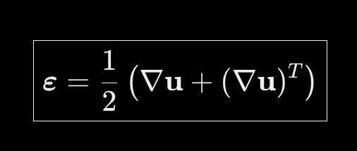
  - IMPORTANT
    - $\gamma_{xy} = 2\epsilon_{xy}$
  - Tensor shear strain $\epsilon$ 
    <!-- - Compares to original length -->
    - Uses deformation (gradient)
  - Engineering shear strain $\gamma$ or $e$
    <!-- - Compares to instantaneous length -->
    - Uses the change in ANGLE / rigid body rotation
    - Is just the tan/ratio of angle
- Stress
  - No distinction for engineering vs. tensor
  - Original stress
    - Force over area
  - True stress
    - Force over ACTUAL area

## Stiffness and Compliance

- One-dimensional linear elasticity (Hooke's law)
  - $\sigma = E \epsilon$
  - With Young's Modulus
- Stiffness matrix
  - Generalization of Hooke's law
  - $\sigma_v = C \epsilon_v$
  - Maps strain to stress
- Compliance matrix (inverse)
  - $\epsilon_v = S \sigma_v$
  - Maps strain to stress

## Poisson Coupling/Deformation
- Stretches in perpendicular directions (Poisson's effect)
- Using Poisson's ratio
- This: $e_1 = \frac{\sigma_1}{E_1}$
  - but ALSO this: $e_2 = \nu_{12} e_1$
- This is why we need a matrix
- $\nu_{12} = - \frac{e_2}{e_1}$
  - even if $\sigma_2 = 0$

- With compliance matrix:
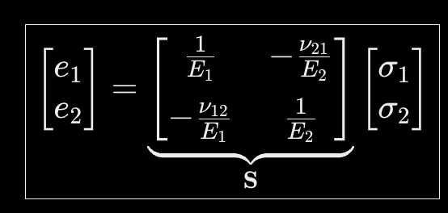

## Adding Shear to Compliance
- $S_{eng}$
- $\tau_{12} = G_{12} e_{12}$
- 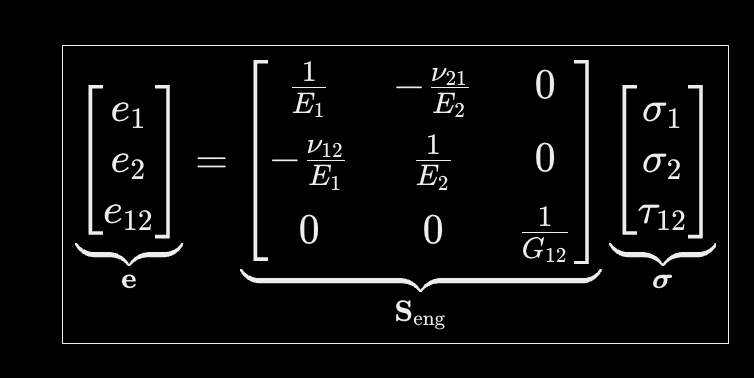
- Generally using orthotropic materials so no shear coupling terms

# Rotating
- Rotating a tensor
  - 
  - 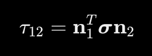
- Rotating a vector
  - 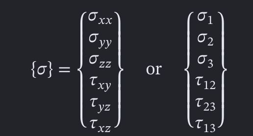
  - Same for tensor strain
  - $\{\sigma\}' = [T] \{\sigma\}$
  - $\{\epsilon\}' = [T] \{\epsilon\}$
  - $\{e\}' = [R] [T] [R]^{-1} \{e\}$

## Reduced Stiffness
- $Q$ -> $C$ with different diagonal shear components, and 2D because plane stress
- ENGINEERING strain into stress
- $\sigma = Q e$
- In shifted frame
  - $\{e\}' = [T] [C] [R] [T]^{-1} [R]^{-1} \{\sigma\}$
  
## Stress
- Expressing same stress tensor in different basi
  - Coupling terms might appear
- e.g. Rotating for $90 \degree$ flips $\sigma_1$ and $\sigma_2$ but negate $\tau_{12}$

## Strain
- Rotating tensor strain does the same thing, but engineering strain is different
- $\epsilon_1 = m^2 \epsilon_x + n^2 \epsilon_y + 2mn\epsilon_{xy}$
- $e_1 = m^2 e_x + n^2 e_y +\ mne_{xy}$
- Transformation matrix
  - Tensor strain transforms using $[T]$, but get to $e$ multiply by Reuter matrix $\{e\} = \{R\} \{\epsilon\}$

# Types

## Orthotropic
- 3 perpendicular planes
  - 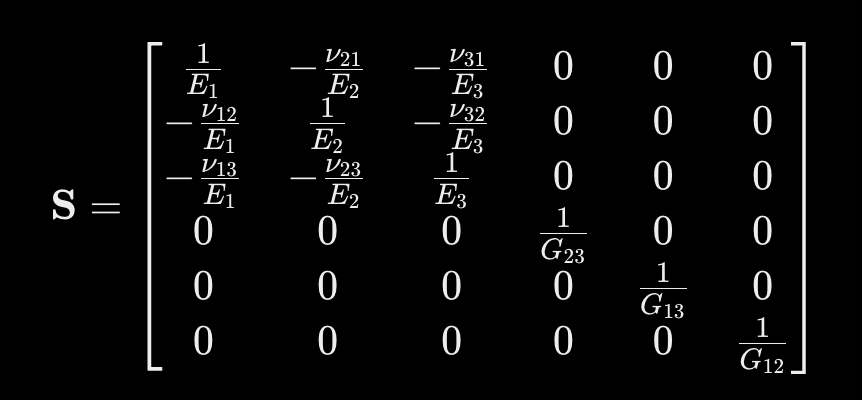

## Isotropic
- Same in all directions
- Compliance ($S$)
  - 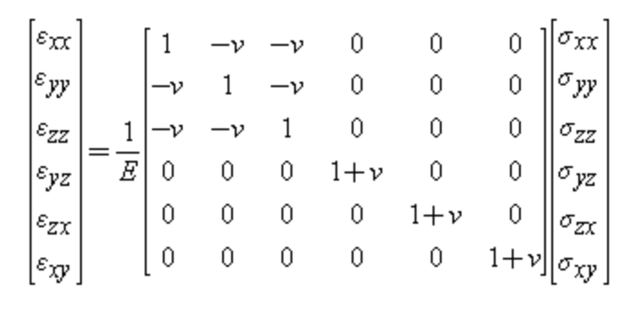
- Stiffness ($C$)
  - 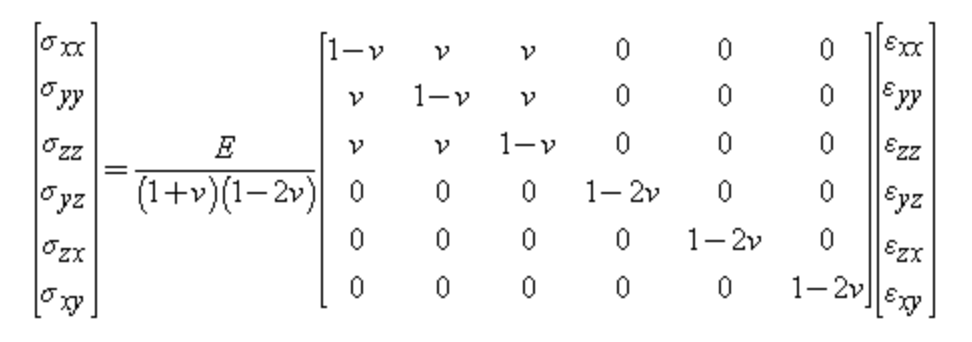

TODO: TO BE CONTINUED with this

# A,B,$\alpha$,$\beta$,$\delta$
- Describes how a laminate responds to in-plane forces and moments
- Stiffness
  - 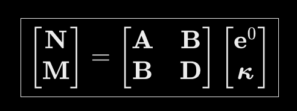
  - with $\kappa$ being curvature and $z$ to midplane
  - 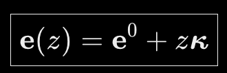
  - 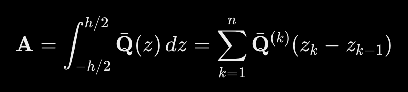
  - 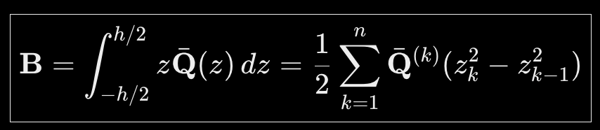
  - 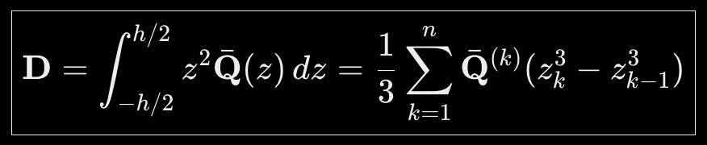
- Compliance
  - 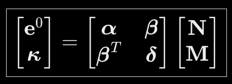
- strain in-plane
  - with $\kappa$ being curvature and $z$ to midplane
  - 
  - If $B = 0$
    - 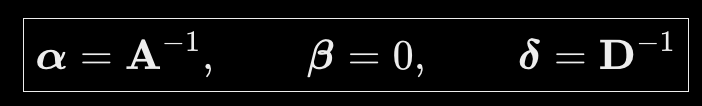
  - 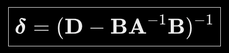
  - 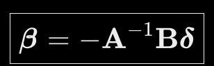
  - 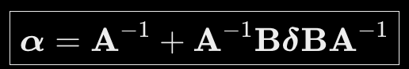
- Symmetric laminate
  - $B = 0$
  - 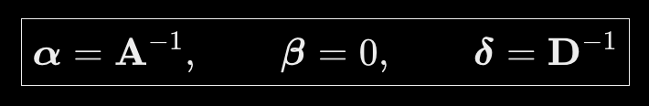