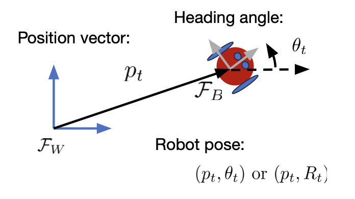
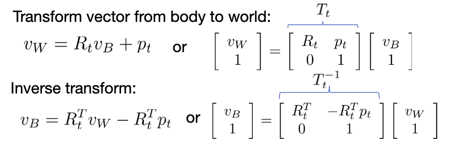
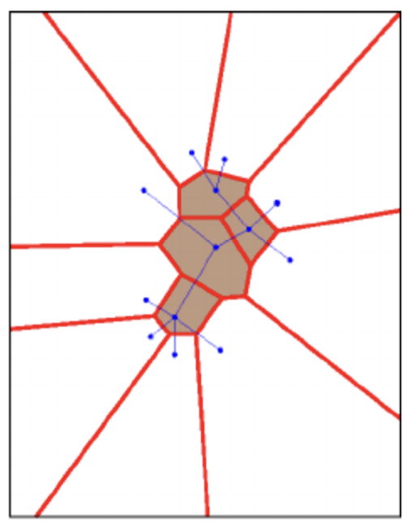
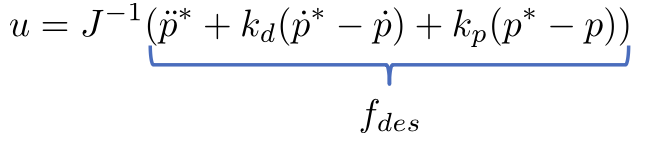
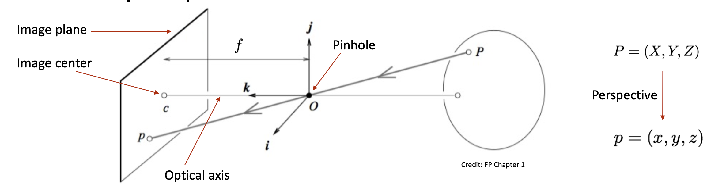
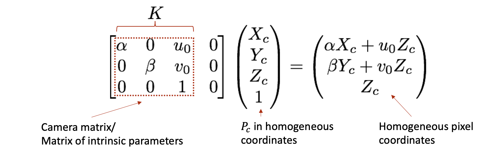
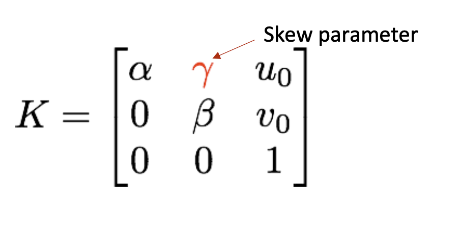
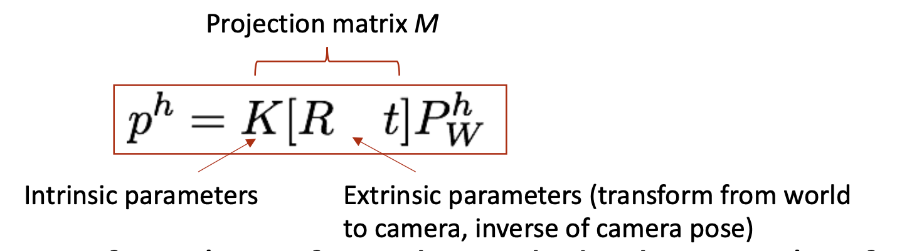
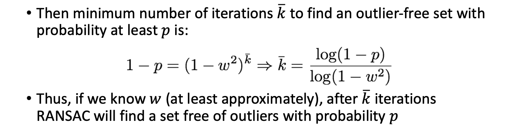

# Midterm Review!

## Robot Stack Overview
- Models
  - Dynamics, how things move
  - Agents, objects (brains)
  - Maps
- Action
  - Path planning (A*, RRT, RRT*)
  - Trajectory Optimization, following
- Perception (observation)
  - Localization (EKF)
  - Info extraction (CV, lidar)
  - Sensors (IMU)

## Models

### Maps
- Free and occupied space in  *world frame* for ColA and path planning
#### **Occupancy Grid Map**
- Probability of occupying a specific grid cell GIVEN sensor measurements
- Transform to Log-odds
  - transforms 0-1 odds to -inf to inf
- Probability of being at point P
  - Bayes' Rule
#### **Point Cloud**
- Gaussian probability of being somewhere GIVEN sensor measurements
  - EKF or factor graph

### Robot Geometry
- Shape is relative to **body** coordinate system
- Simple spheres, cylinders, capsules
  - [URDF](https://en.wikipedia.org/wiki/URDF)
- Triangular mesh
  - [STL](https://en.wikipedia.org/wiki/STL_(file_format))
- Point Cloud

### Coordinate Frames and Transformations
- Variables
  - $R_t$: matrix such that `v_world = R_t * v_body`
    - Columns are each individual body vector expressed in world frame
  - $p_t$: vector from origin to body in WORLD frame
- 
- 
- Other things
  - Euler angles (ew)
  - Quaternions (YAY)
  - Angle axis (ooh)

### Collisions and C-space
- Configuration-space
- Hard to check all points on body for collision
  - Keep-out region equal to radius?

### Robot Kinematics and Dynamics
- Kinematics
  - How robot moves in general
- Dynamics
  - How robot moves with forces and other things too
- Linear vs. nonlinear state space model

### Agent Models
- Predict then plan
  - Predict behavior with dynamics, intent, and decision model
    - Assumes agent plans optimal trajectory
  - Treat as moving obstacles
- Game theoretic
  - Choose robot and agent actions jointly
- Learning based
  - Distribution over plausible futures
  - Dominant model for complex environments
  - Can predict agents jointly

## Path Planning!
- Path Planning
  - Graph-based
    - A*
  - Sample-based
    - RRT, RRT*

### Graph-based planning
- Graph search
  - Cell either free or occupied
- Random graph / sampling
- Goal
  - Minimize cost with dynamic, collision, etc. constraints
  - Find **dynamically feasible** trajectory
  - Use feedback control to track it

#### Label Correcting Algorithm
- Tracks ***Cost-to-come*** from $q_I$ to $q$
  - All $\infty$ except for start node at 0
  - Remove `q` from frontier queue and repeat
    - If parent cost plus parent-to-child cost is less than previous version OR UPPER limit, label correct update, and put new node in frontier queue
- How to prioritize
  - **Depth-first search**
    - Goes down first, last-in first-out
  - **Breadth-first search**
    - Current depth only
  - **Best-first**
    - Requires non-negative cost

#### A*
- Add heuristic as approximate "cost-to-go"
- **Admissible** if it does't overestimate cost
- Fewer nodes in frontier queue
  - cost + cost_from + HEURISTIC ≤ UPPER
  - UPPER being the highest cost so far (that we want to beat)
- Simple and fast, but need small grid for better solution
- Need simple robots because of degrees-of-freedom
  
### Combinatorial Planning
- We create a roadmap
  - Every vertex is connected
- Discrete representation of continuous motion *without losing* original connectivity
- Cell decomposition
  - Each vertex get vertical line
    - Go from midpoint or other intersection
- Compute free space using obstacles and shape of robot (keep-out zones)
- But
  - Robot-specific, difficult to implement with some geometry, computational

### Sampling-based Planning
- Random-sampling
- Black box collision checker
- BUILD roadmap
- Turn global problem into local/easy

#### Probabilistic Roadmap
- Multi-query (preprocessing THEN solving)
- Preprocessing
  - Throw samples across space, keeping good ones
  - Lined between adjacent ones within a radius
- Use a graph-based solver now

#### Rapidly-exploring Random Trees (RRT)
- Single-query (makes roadmap AND solves at once)
- Process
  - Pick random vertex
  - Make edge from nearest other vertex (with max length)
  - Sometimes pick target vertex to go toward
- Works well because of **Voronoi Bias**
  - Frontier regions have larger cells that are more likely to have sampling, so it explores well
  - 
- RRT can product bad paths
  - Does not revise connections with more efficient choices

#### RRT*
- Check adjacent vertices to see if the new vertex is better connected to other edges in a certain radius $r_n$

#### Probabilistic Completeness
- How many samples do we ned
  - Probability of finding goal is 1 if you keep iterating
  - For PRM, cost guaranteed to converge if the radius parameter is this, where $\gamma$ only depends on $d$:
$$
r_n = \gamma \left(\frac{\text{log}\, n}{n}\right)^\frac{1}{d}
$$
- PRM has good paths but could be costly checking
- RRT finds path quickly
- CANNOT DETERMINE IF PATH DOES NOT EXIST

## Trajectory Optimization!
- Paths specify geometry, but trajectory requires **time** and **input** too
- Idea: for all states/inputs, minimize cost with
  - Stage/running cost across all time, and terminal cost
  - Dynamics/kinematics, initial/final conditions, system constraints
- Difficult because no closed-form solution

### Solutions
- Open Loop: nominal input
  - Deviation with disturbances, and sensing or model error
- Closed Loop: policy
  - Nominal input + tracking feedback

### Approaches
- Direct Methods
  - Discretize THEN optimize
  - We focus on **THIS**
  - Shooting
    - Single ($u$) and multiple ($u$ and $x$) shooting
- Indirect Methods
  - Pontryagin’s Minimum Principle!!!
  - State, costate, boundary conditions
- Both require numerical choices and initial guess

### Direct Methods
- **Discretization**
  - Zero-order hold since it keeps the same input for each timestep
  - Finite number of inputs over time to optimize 
  - Euler, RK2, RK4, etc.
- **Optimization**
  - Optimize decision variables $z$ given equality and inequality constraints
  - $z$ could be controls, states, polynomial coefficients
- Gradient descent
  - $z^{j+1} = z^j - \alpha_j \nabla J (z^j)$
  - Step size $\alpha > 0$
- Non-convex
  - Can go into local minima
  - Random restarts
- Convex
  - Global minimum 
  - Positive semi-definite
- Feasible motion
  - Constraints can block descent

#### Inequality constraints
- Active and inactive
- **Sequential Quadratic Programming**
  - Approximate by quadratic problem
- **Interior Point Methods**
  - Cost from barrier gets higher as you approach it by log factor
  - Encourages interior points
- Warm starting
  - Reuse previous solution/multipliers/info

#### Shooting
- Single
  - Optimize over inputs
  - Shoot the complete horizon, then derivative
  - Sequential rollout, NOT easy to parallelize
  - CANNOT choose initial state/path guess very easily
  - Useful in
    - Compact problems, manageable horizons, rollout-based (like iLQR)
- Multiple
  - Optimize over inputs AND states
  - Derivatives, cost, etc. can be parallelized
    - Expressions only need to be between adjacent points (for the most part)
  - Can choose initial state guess 
  - Not dynamically feasible until it converges

#### Cool ones
- LQR
  - Drive to 0
- iLQR
  - Drive to 0 AND iterate to get nominal input/state
- Minimal-snap trajectory planning

## Trajectory Following
- Closed loop feedback to reject disturbances and model errors
- No **continuously differentiable** feedback control law to stabilize nonholonomic system to desired pose

### Feedback Linearizing Controller
- e.g. with position $p$ 
- 

### LQR-based controllers
- You know what this is
- Requires linear dynamics and only regulates state to 0
- Works for arbitrary dimension systems and performs well

### Gain-scheduled LQR
- Policy/feedback-based now
- Apply gain from closest point
- Iterate to find optimal trajectory/inputs

## Differential Flatness
- If we can find a set of outputs
  - All states and inputs can be determined from these outputs (no integration)
- Process
  - Define initial and final conditions
  - Build curve for all time with splines
  - One spline for each direction

## Perception Stack Overview
- Passive
  - Measure ambient environment entering sensor
  - Performance depends on environment
  - e.g. Temperature probes, cameras
- Active
  - Emit energy and measure reaction
  - Might affect environment 
  - e.g. Ultrasonic, laser rangefinders

### Proprioceptive
- Values internal to robot
- e.g. accel, voltage, joint angles
- **IMU**
  - *Rate gyroscope* (angular velocity)
  - *Accelerometer* (proper acceleration)
  - *Magnetometer* (magnetic field)
  - All of these have biases
  - Orientation
    - Low pass accel for gravity
    - Cross B field to get East, then again for North
  - NED (north, east, down) frame
- **GNSS**
  - Time-of-flight to get distance, sat locations for endpoints

### Exteroceptive
- Measure environment
- e.g. distance, light intensity
- Active Randing
  - Time-of-flight (ultrasonic, laser rangefilter)
  - Geometric (optical triangulation, structured light)
- ALL output point clouds
- **Geometric Active Ranging**
  - Use geometric properties in measurements to establish distance
  - Project known light pattern, reflection captured, triangulation
- **Point cloud alignment**
  - Align point cloud A to point cloud B
  - Relative pose: Transform to move A to B

## Computer Vision!
- Geometric
- Point Cloud Alignment
  - ICP: Iterative Closest point

### Problem
- Over translation and rotation, minimize error
  - Based on SVD (**Wahba's Problem**)
  - Left and right nulls spaces, singular values
- Least norms solution
  - Based on smallest singular value or something
- SLAM
  - Lidar: relative poses between scans
  - Pose graph with nodes and relative measurements
  - Front-end: post graph from sensor measurements
  - Back-end: Optimization to find consistent set

### CV Geometry
- Intrinsic parameters:
  - Camera calibration matrix $K$
- PnP: N Point Perspective
  - Match 2D image points with 3D points in pre-existing model
- SfM: structure from motion
  - 3D locations based on pairs/collections of images from different perspectives
- Semantic
  - Classification: what's in it?
  - Detection: Draw boxes around 
  - Segmentation: Actual pixel masks 

### Pinhole Camera Model
- From thing in the world (relative to origin of the 3D optical frame) into pixel points
- Pinhole to block most of rays but let in a little bit of light
  - Inverts image
  - 
- Process
  - Map point $P_w$ from world frame to $P_c$ camera frame
  - Project point onto image plane to get $p$
  - Transform to $(u,w)$ pixel coordinates
- Perspective Projection
  - 
  - Pixel coordiantes ARE on the left due to the transformation with $\alpha$ and $\beta$
  - Could have skew (unlikely)
    - 
- Full transformation chain
  - Gets points from world coordiantes
  - 

### Direct Linear Transformation Model
- From correspondences, calculate $K$, $R$, $t$
- Image only gives 2D information so you can't know in 3D without more of them

### Algorithms
- Camera Calibration
  - $2n$ component-wise equations for $i = 1, ..., n$
  - Extract camera parameters via RQ factorization
- Perspective Projection

### RANSAC
- Random Sample Consensus
- Process
  - Take 2 points
  - Get all inliers that are close enough to a line/transformation
  - Keep track of line with most inliers
- In principle, need to check all combinations
  - combos = $\frac{N(N-1)}{2}$, which is a lot
- Approx of percentage of inliers
  - $w = \frac{\text{number of inliers}}{N}$
  - e.g. If 99% finding points free of outliers
- 
- $\bar{k}$ depends only on $w$, not $N$

### CV Pipeline
1. Input 2 images, or image and 3D model
2. Feature detection/matching -> correspondences
3. RANSAC to reject outliers
   - Sample n features
   - solve geometric problem with correspondences
   - Check solution fit, return highest score
  