# AA 279B Midterm Review

## Restricted Three Body Problem
- Three Body Problem
  - No general closed-form solutions
  - Can integrate numerically
- Restricted Three Body Problem
  - Third mass is small, so now 2 masses orbiting each other
  - **Barycenter**: Center of mass of both large bodies (things orbit around this)
  - Now can use 2-body solution, just with 2 forces instead of 1

### Circular Restricted Three Body Problem
- Simplified into circles
- Good model for Earth-Moon and Sun-Earth
- 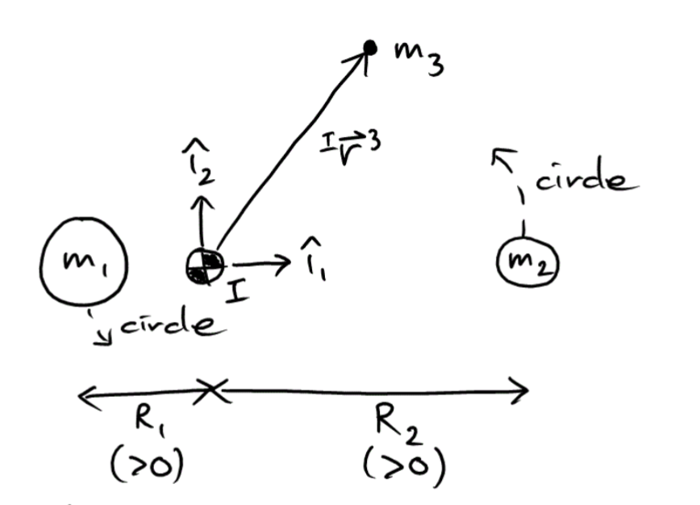

### Synodic Reference Frame
- Rotates with the bodies
- New apparent forces
- Derivation
  - Coriolis to relate velocity, then derive again for acceleration
  - 2 new terms (centripetal/centrifugal, coriolis) with respect to BARYCENTER
- 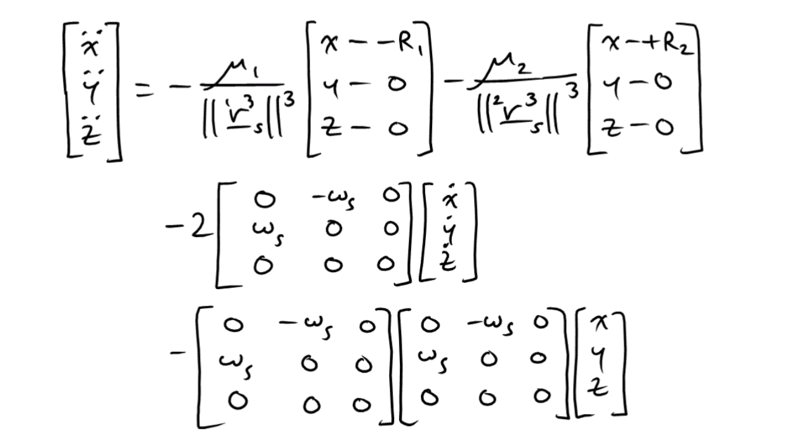

### Nondimensional EOMs 
- $\mu^*$ for mass fraction of body 2
- Time unit so that $\omega_s$ is 1
- TODO

### Effective Energy
- 2 terms: PE and KE
- Effective potential energy
  - Extra term with angular rotation (energy due to the frame rotating)
  - $C3 = -2*PE_{eff}$
- Effective kinetic energy
  - Energy due to the actual motion w.r.t synodic system

### Restricted Zones
- $PE_{eff}$ must be less than $\varepsilon_{eff}$
- 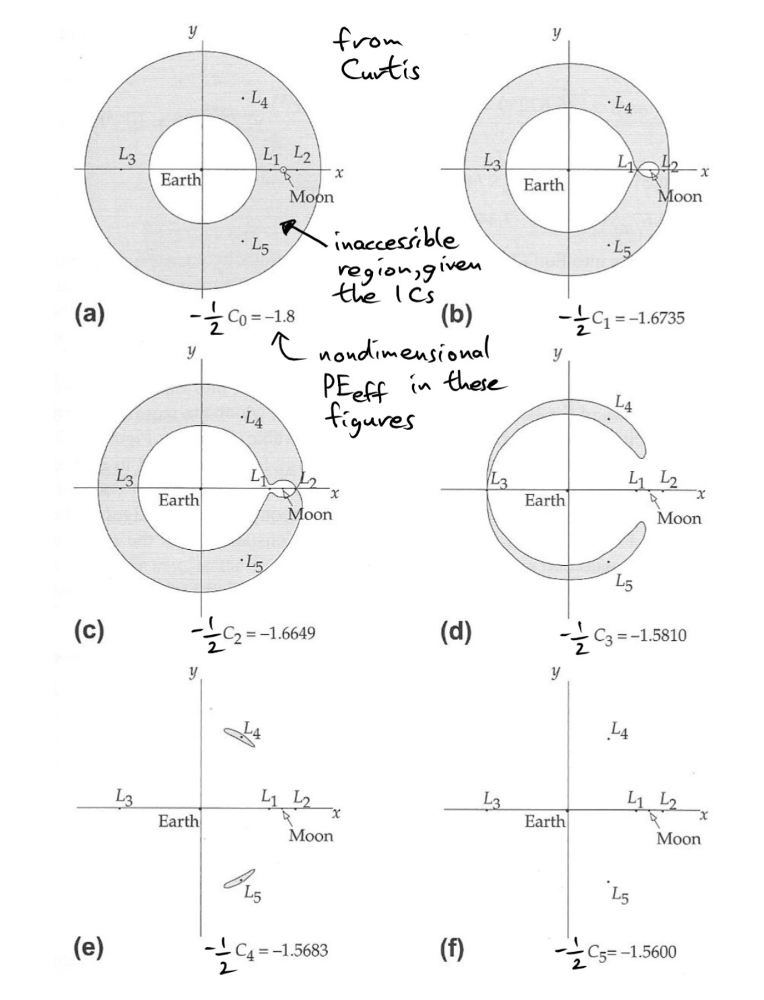

### Lagrange Points
- When $\ddot{z}$ = 0
- 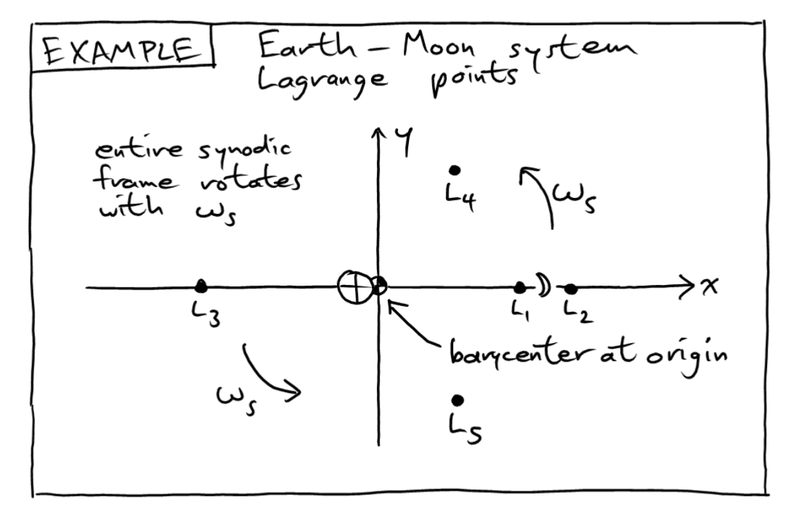
- Go up from L1 to L5 in specific energy
- **L1,L2,L3**
  - Order: Inside, Right, Left
  - Colinear
  - Saddle points, pulled toward $x=0$ but diverge in $y$ if displaced from point (force balance)
  - Can keep in quasi-periodic orbits around these points (stationkeeping)
- **L4,L5**
  - Order: Top, Bottom
  - Equilateral triangles (force balance)
- Stabiltiy
  - Linearize around synodic acceleration (mainly gravity terms)
  - Cool orbits

### Targeting
- Jacobian
  - Rows for derivative w.r.t the quantity
  - 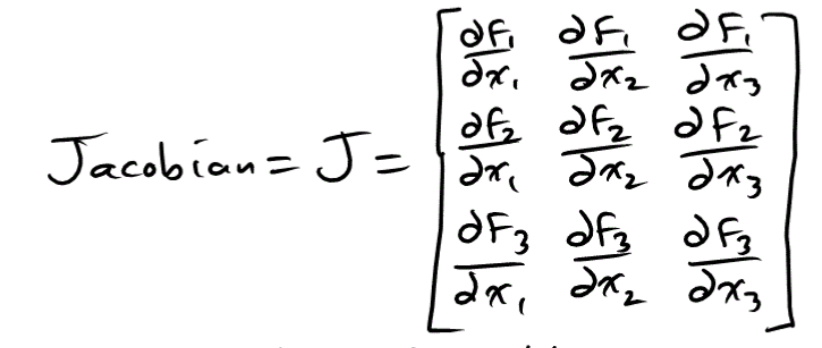
  - NEWTON RAPHSON I think
- $v_{N+1} = v_N + J^{-1} \delta r_N$
  - Need $J$ to be non-singular
- $r_{2, err} = \frac{d r_2}{d v_{+1}} {v_{{+1}, err}}$

## Relative Orbital Motion
- RSW frame (radial, along-track, normal)
  - Perturbing forces in this frame
  - Convention is x up, y to LEFT
- Mean motion
- Circular orbit
- Deriving assumptions
  - $x_{RSW} << \rho_{orbit}$
  - $\theta$ small enough to approximate as along-track distance
- **Clohessey-Wiltshire Equations**
  - **LINEAR, TIME-INVARIANT**
- $z/w$ axis simple harmonic motion
  - Represents different inclination
- $x$,$y$ coupled and in a matrix
  - Split into block form
  - 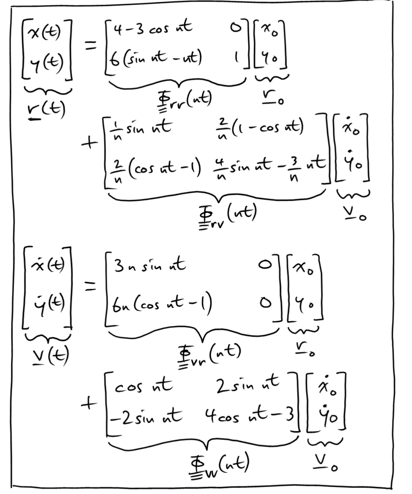
- State transition matrix eigenvalues
  - $\lambda_1 = 0$: along track same radius
    - Same orbit, different anomaly
    - Constant phase offset
  - $\lambda_2 = 0$: $x_0 \neq 0$, Rate only in $y$
    - Different $a$, behind or ahead
    - Radial offset, secular drift
  - $\lambda_{2,3} = \plusmn jn$
    - Elliptical oscillations around target (not necessarily centered)
    - Different $e$ than target orbit
  - **ALL orbits some linear combination of these**

### HCW Two-point Boundary Value Problem
- (or 3 points depending on 3D or not)
- LTI system gives state from initial conditions!
  - For $z$ axis, if desired final $z$ velocity is 0 (without perturbations)
    - Lies in same orbital plane
    - No unique solution for $z_0$ then
- Intercept analysis
  - Solve for initial conditions given time of flight (like Lambert problem)
  - 2 burns
  - Graph (time from first burn $y$, delay until first burn $x$)

### Forced CW solutions
- e.g. Drag in $-y$ direction
  - x direction falls, but y speeds up
  - But orbital energy decreases in the form of heating (which is how the force happens)

## Lambert's Problem
- Also "Gauss Problem"
- Given $\vec{r_1}$ and $\vec{r_2}$ and $t_{flight}$, find orbital elements
  - Solution gives $\vec{v}$ at both points
- Assumptions
  - 2-body motion
  - Inertial frame
- Applications
  - Orbit determination
  - Orbital transfer
  - Targeting/intercept/rendezvous
  - Mission Planning

### Solutions
- Large family of orbits
- Transfer method
  - Short/long way
  - \# of revolutions
  - Prograde/retrograde
- Ensure it doesn't pass through central body
- Solvers often find focus of conic 
  - Then can find velocity vectors
  - This determined ellipse vs. parabola vs. hyperbola
- Locus of vacant foci
  - Derive via definition of ellipse and distances
  - Itself is a hyperbola with foci at both points
    - One branch for elliptical orbits 
    - One branch for hyperbolic orbits
- Minimum energy ellipse
  - Same as minimizing $a$ with equation
  - Can solve analytically
  - Equations
    - chord $c$ between both points, minimum energy sma $a_m$
    - $a_m = \frac{r_1 + r_2 + c}{4}$
    - So semiperimeter $s$
    - $s = \frac{r_1 + r_2 + c}{2}$
    - $a_m = \frac{s}{2}$
    - $p_m = \frac{r_1 r_2}{c}(1 - \text{cos}\Delta \nu)$
    - $e_m = \sqrt{1 - \frac{2 p_m}{s}}$
- Minimum eccentricity ellipse
  - Loci of topics of eccentricity vectors traces line perpendicualar to chord $c$
  - $e_s = \frac{r_1 - r_2}{c}$

### Lambert's Theorem
- Postulated $\Delta t = f(r_1 + r_2, c, a)$
  - Lagrange proved
- Lagrage Time Equations
  - 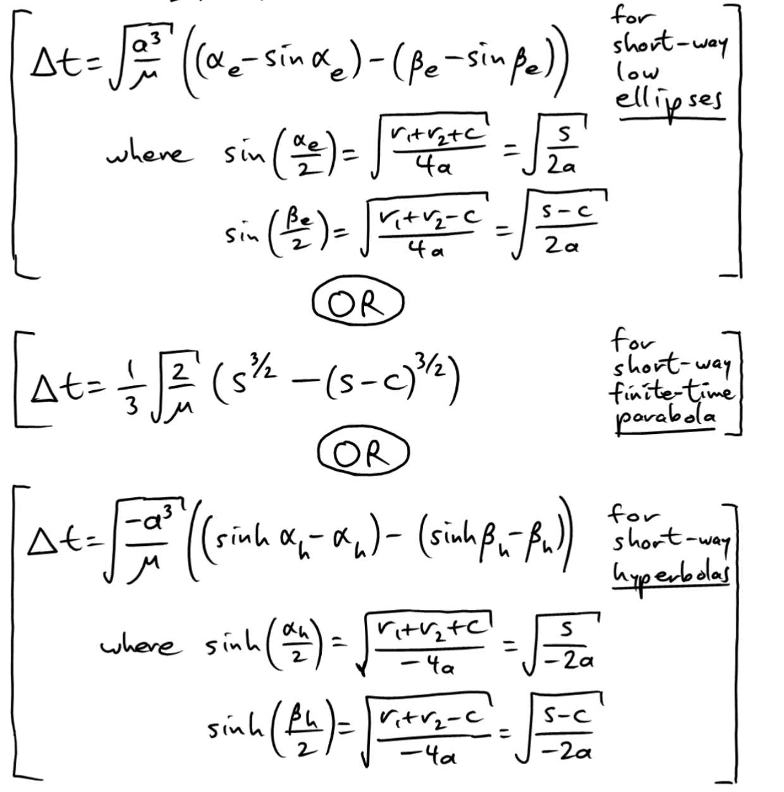
- Short-way Minimum Energy
  - 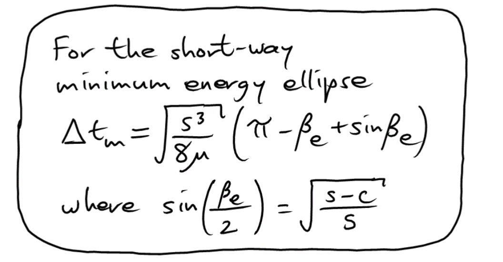

### Solving
- Iterate on $a$ (inferior)
- Iterate on $p$ (inferior)
- Universal variables iterate on value related to anomaly (Vallado, BMW, Battin)
  - $f$ and $g$ functions
- Check that trajectories don't hit
- Solvers have trouble near $180\degree$

#### Issues with solvers
- Multiple revolutions
  - Phasing sometimes, but most likely not done
- Short/long Way
  - Approach is to run for long AND short to decide
  - Some solvers return pro/retro
- Transfer angle near $180\degree$
  - Short/long being similar
  - Sudden jump in nature of solution
  - Non-unique plane at $180\degree$
  - Small numerical changes change plane drastically
- Short transfer times
  - Hyperbolic or parabolic
  - High energy
  - Screen by filtering on less than escape velocity
  - 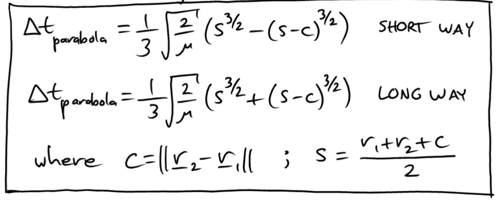
  - 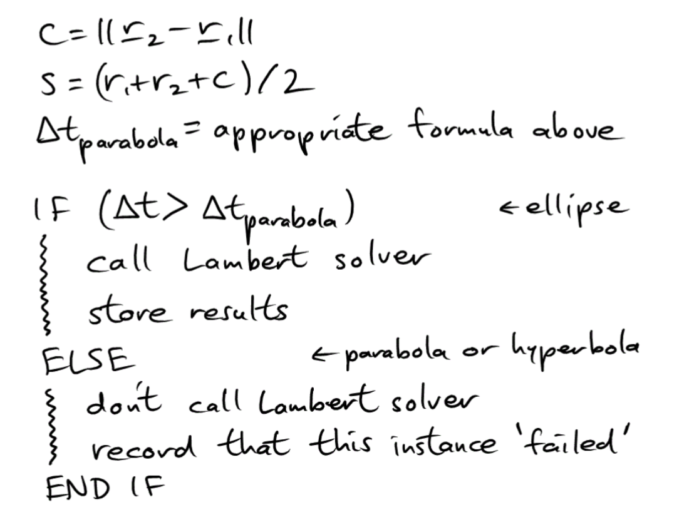
- Hitting central body
  - Don't
  - 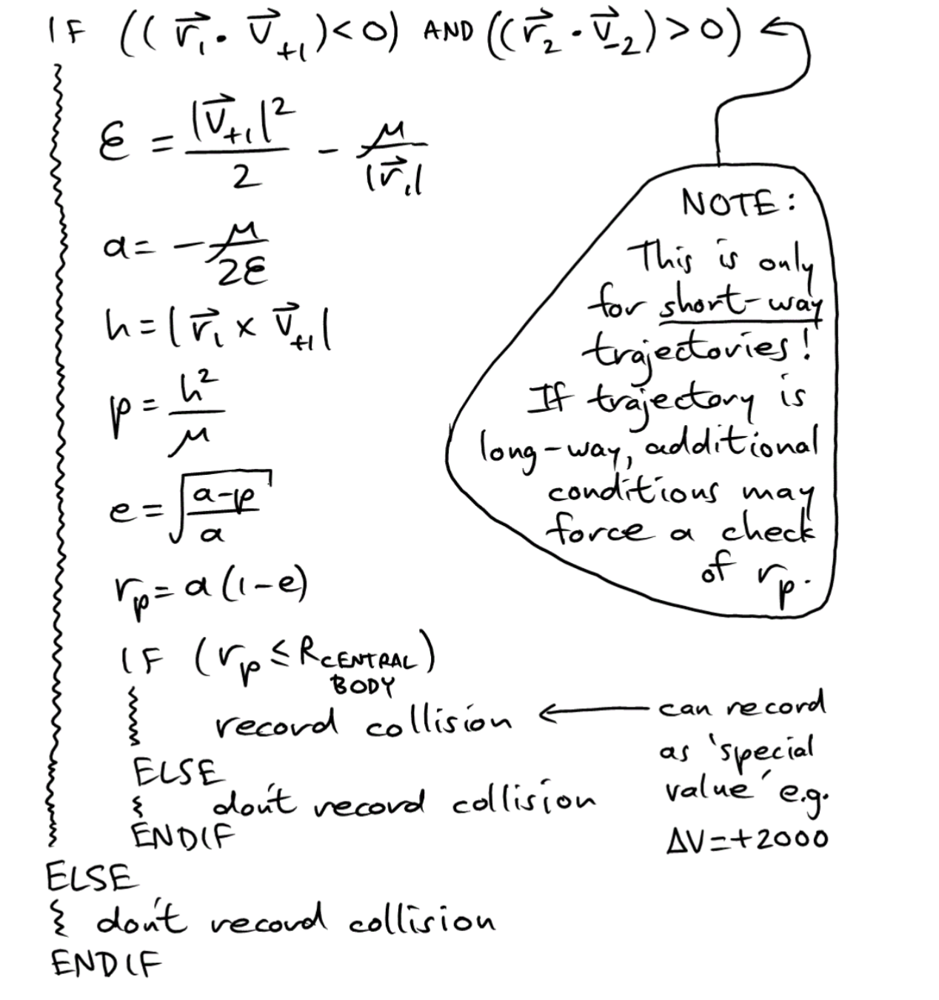

### Ground-to-orbit Intercept/Rendezvous
- Procedure
  - Choose launch and arrival time
  - Lambert for velocities
  - Get $\Delta v$
  - Plot is periodic with period similar to orbit's
- Reading
  - Minimim $\Delta v$ with contours
  - Smallest total time until intercept/rendez is diagonal line
  - Smallest flight time horizontal lines

## RF and Comms
- All parts of link budget
  - A bunch of multiplication OR adding decibels
  - 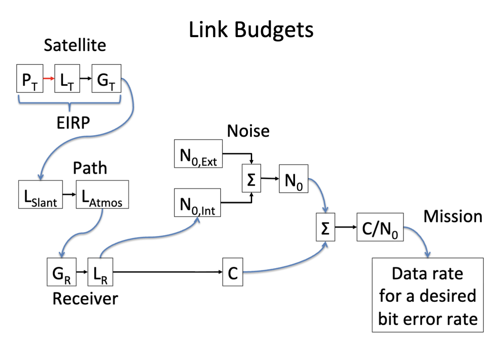
- **Transmitter**
  - *Power, Loss*
  - Power spatial density
    - Power over surface area of what it covers
    - 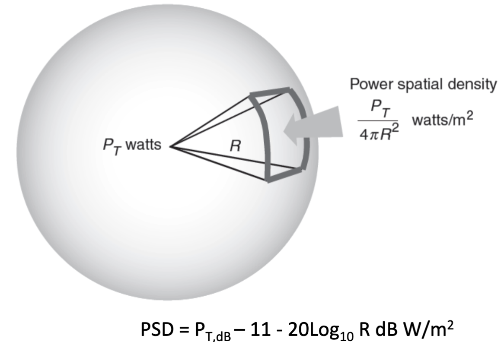
- **Path**
  - *Slant range*
    - Get nadir angle and state vector position based on elevation
  - *Atmospheric loss*
    - Gas and vapor attenuate differently at frequencies
    - Pick frequency with the least attenuation
    - 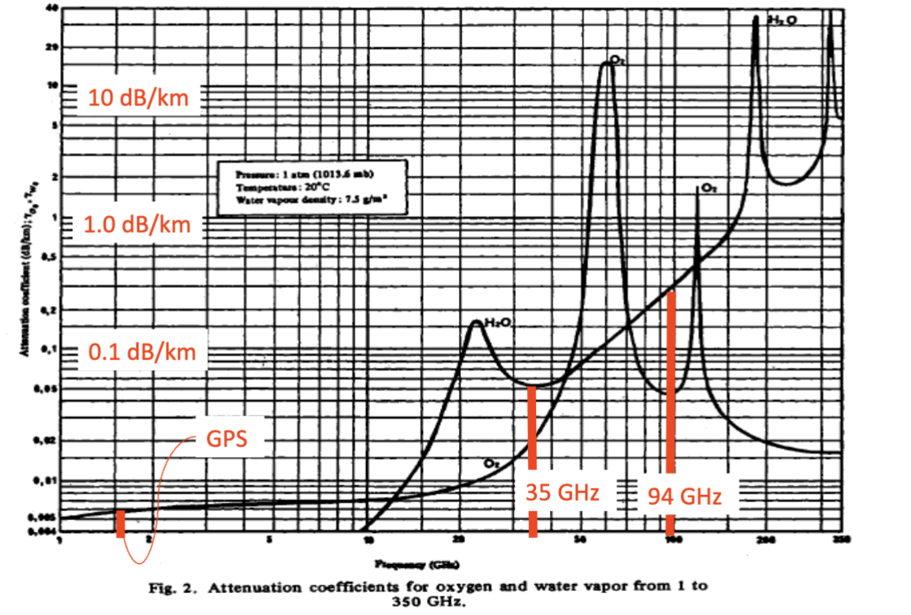
- **Power spectral density**

- **Reciprocity Theorem**
  - Antenna can receive and transmit same power

- Carrier-Noise Ratio
  - 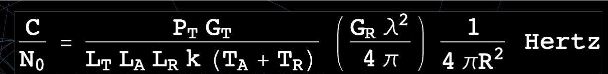
  - Free space path loss
  - 

### Example satellites
- Sirius XM
  - All 3 have same ground track (wow)
